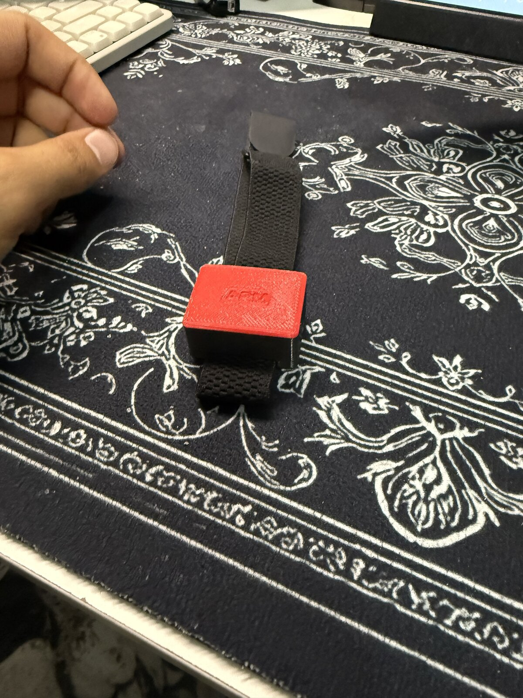

# VolleyBand

A wearable motion sensor for volleyball. Two small pods, one strapped to the arm and one to the ankle, measure arm swing and jumps 100 times a second and stream everything to a laptop over Bluetooth.



## Why

Runners have GPS watches. Lifters have rep counters. Volleyball players have almost nothing that measures what actually matters on the court: how fast the arm swings on a spike and how high you jump. VolleyBand is an attempt to measure both with cheap parts and a 3D-printed case.

## What's in a pod

| Part | What it does |
|---|---|
| Seeed XIAO nRF52840 Sense | The board: Bluetooth, charging, and a built-in LSM6DS3 motion sensor (accelerometer + gyroscope) |
| EEMB LP402535, 3.7 V 320 mAh LiPo | Battery, soldered to the BAT+ and BAT- pads on the back of the board |
| 3D-printed case + snap-fit lid | Holds everything. The strap threads through a tunnel underneath so the pod can't spin on the band |
| MOOFIT strap | Holds the pod on the arm or ankle |
| Double-sided foam tape | Sticks the battery to the case floor |
| Kapton tape | Insulates the battery from the back of the board |
| Foam pad | Sits on top of the board so the lid presses everything flat |

Sensor settings: accelerometer at ±16 g, gyroscope at ±2000 deg/s, sampled at 100 Hz.

## Repo layout

```
firmware/
  sensor_test/       first test sketch: prints sensor readings over USB
  volleyband_ble/    Bluetooth firmware that runs on both pods
laptop/
  volleyband_logger.py   connects to both pods and saves every reading to CSV
cad/
  pod_case_v4.scad   the case and lid, fully parametric (OpenSCAD)
  stl/               ready-to-print files
  renders/           pictures of the model
  archive/v3/        the previous version, kept for reference
data/                recorded sessions
docs/                build log, assembly guide, Bluetooth message format
photos/              the build, from parts to finished pod
video-tools/         scripts used to film the code and CAD being written
```

## Quick start

**1. Flash the pods**

- Arduino IDE 2, board package *Seeed nRF52 mbed-enabled Boards*, board *XIAO nRF52840 Sense*
- Libraries: *ArduinoBLE*, *Seeed Arduino LSM6DS3*
- Open `firmware/volleyband_ble/volleyband_ble.ino` and upload it. Change `DEVICE_NAME` to `"VolleyBand-ANKLE"` before uploading to the second board.

LED: blue blinking = waiting for the laptop, solid green = connected and streaming, solid red = motion sensor not found.

**2. Run the logger**

```
pip install -r laptop/requirements.txt
python laptop/volleyband_logger.py
```

It finds both pods by name, connects, and writes one CSV per pod into `VolleyBand_Data/`. Press Ctrl+C to stop. Only one pod: `--pods VolleyBand-ARM`.

**3. Print the case**

Print `cad/stl/pod_case_v4.stl` open side up and the lid flat side down, exactly as the files load. No supports. PETG is recommended because the lid clips need to bend.

See [docs/assembly.md](docs/assembly.md) for putting it together.

## Status

- [x] Board and battery wired and charging
- [x] Motion sensor reading over USB
- [x] Case v4 printed, fits, lid clicks shut
- [x] Bluetooth streaming from two pods at once, 100 readings/s each
- [ ] First on-court test: swings and jumps
- [ ] Swing speed and jump height detection from the data

Full story in [docs/build-log.md](docs/build-log.md).
