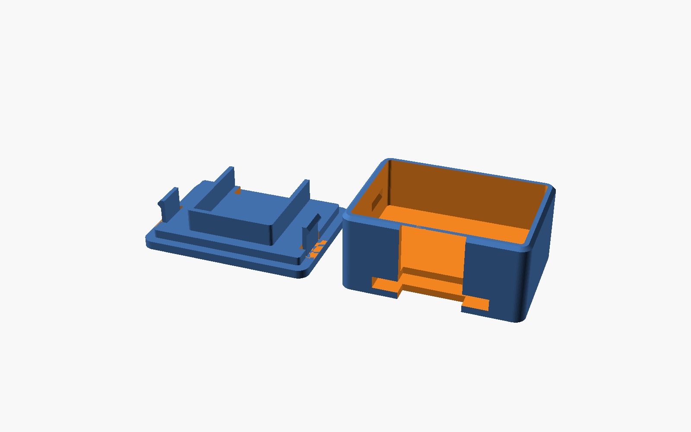

# Assembling a pod

1. **Foam tape on the floor.** Stick a piece of double-sided foam tape to the floor of the case.
2. **Battery.** Press the battery flat onto the foam, wires toward the USB end of the case.
3. **Kapton.** One layer of Kapton tape over the battery so nothing on the back of the board can short against it.
4. **Board.** Lay the board on top with the USB-C port facing the opening in the long wall. The port lines up with the opening, so the pod charges without opening the case.
5. **Foam pad.** Put the foam pad on top of the board. Keep foam off the underside of the board: it lifts the port out of line with the opening.
6. **Lid.** Line up the lid and press down until both clips click. To open it, pry up at the USB opening with a fingernail.
7. **Strap.** Thread the strap through the tunnel under the case.

The thin vertical line on one short end is not a hole. It's an alignment mark: wear the pod the same way round every session so the readings stay comparable.

## Lid fit

The clip strength is set by `engage` in `cad/pod_case_v4.scad` (how far the clip bump hooks into the wall). 0.5 mm holds firmly. Use 0.35 if it's too hard to open, 0.6 if it's too loose, then export the lid again.
