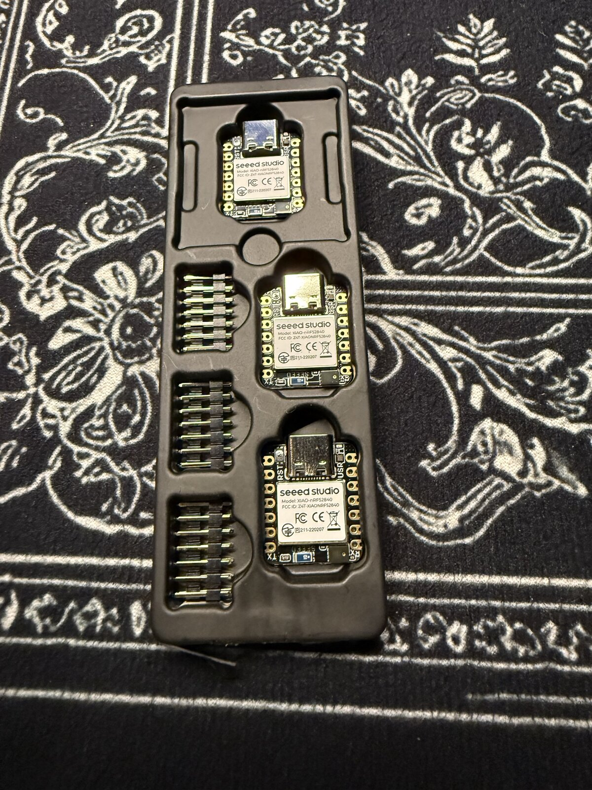
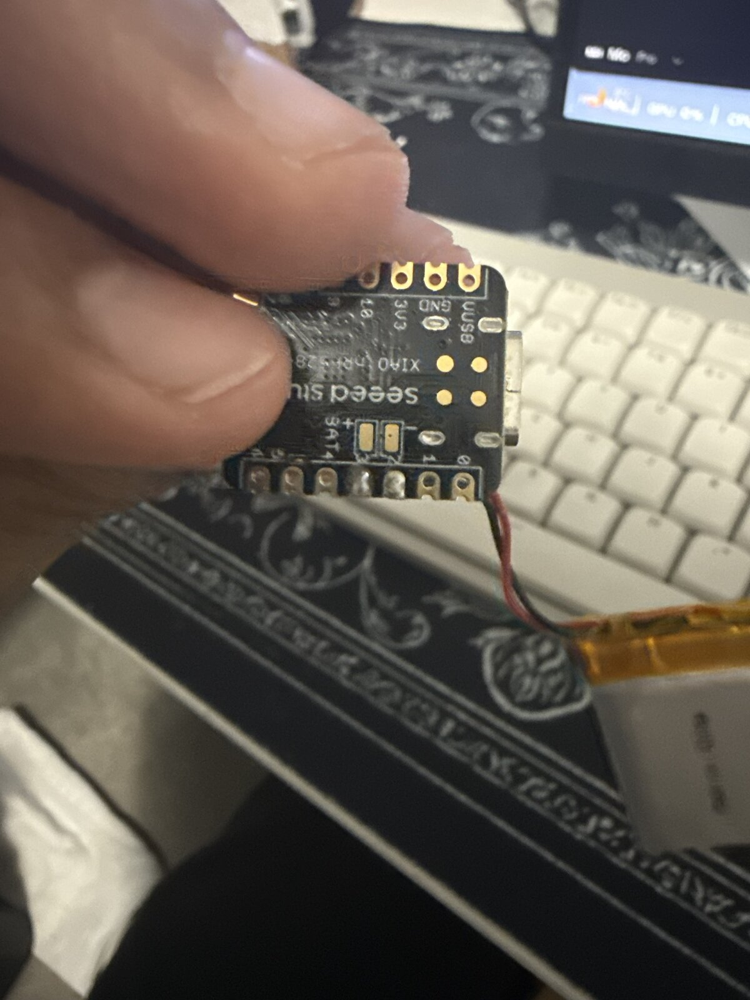
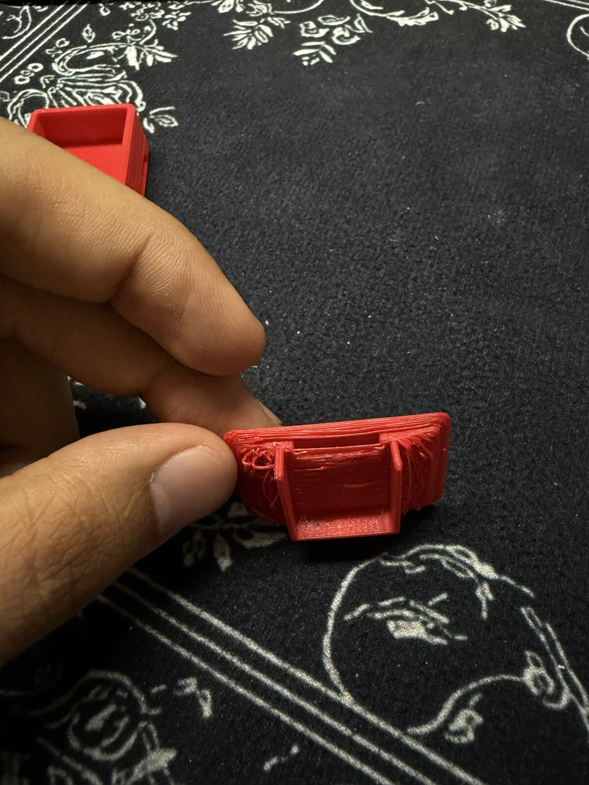
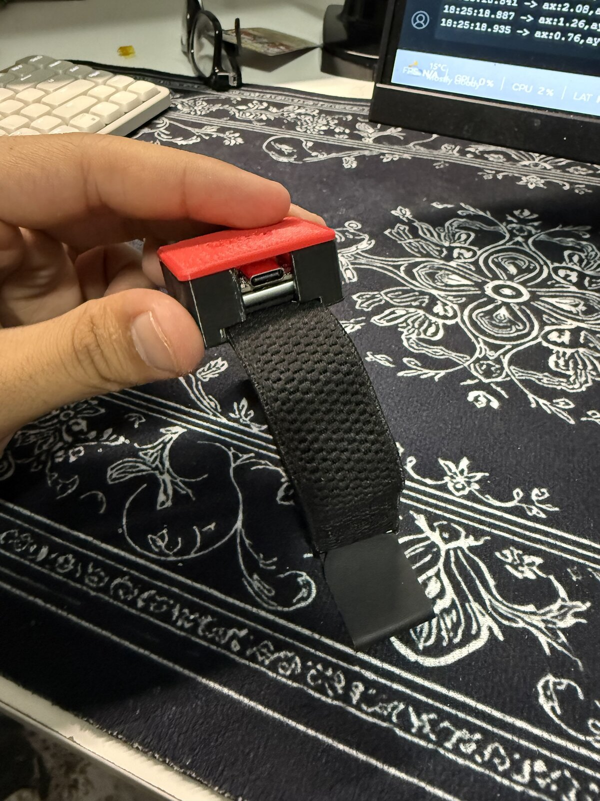

# Build log

## 1. Parts

Three Seeed XIAO nRF52840 Sense boards and EEMB 320 mAh LiPo batteries.

## 2. Battery wiring

The first attempt soldered the battery wires to two edge pins instead of the BAT+ and BAT- pads on the back of the board, so the battery never charged. Moving the wires to the BAT pads fixed it.

## 3. First code: reading the sensor

`firmware/sensor_test` prints acceleration (g) and rotation (deg/s) over USB. Sitting still, the total acceleration reads about 1.01 g: gravity. Printing too many small pieces froze the Serial Monitor, so each line is built first and sent once, 20 times a second.

## 4. The case

Designed in OpenSCAD so every size is a variable.

| Version | What changed |
|---|---|
| v1 | First design |
| v2 | Lid lip was a solid plug that left no room for the parts. Moved the lip into its own rebate, added foam space and board ribs |
| v3 | Board was turned the wrong way: the USB-C port is on the short edge. Rotated it so the port faces the opening |
| v4 | After the first real print (below) |

**First print (v3):** the strap fit perfectly. The lid didn't close: it had been exported upside down, so the flat plate was printed in mid-air on top of the thin ribs and drooped. The plastic under the strap tunnel was also too thin.

**v4 fixes:**
- Lid flipped so it prints flat side down, nothing in mid-air. Label engraved instead of raised.
- Snap fit: two flexible clips on the lid click into grooves inside the case.
- Thicker floor and tunnel roof (1.0 to 1.6 mm, 1.2 to 1.6 mm).
- Bigger USB-C opening, checked in the model with a plug-sized block.

**Second print (v4):** fits, lid clicks shut, port lines up.

## 5. Bluetooth

`firmware/volleyband_ble` samples at 100 Hz and streams over Bluetooth LE. `laptop/volleyband_logger.py` connects to both pods and saves CSVs.

**v1** sent one reading per message. With both pods connected to a Windows PC, the arm pod lost 1 reading in 1,400 but the ankle pod lost about 12%. On its own the ankle pod lost 0, so the board was fine: the PC couldn't keep up with 200 small messages a second from two pods.

**v2** packs up to 8 readings per message. Same test, both pods: ankle lost 0 of about 3,200, arm lost 16 (two messages).

Recordings: [data/2026-11-02_bench_test](../data/2026-11-02_bench_test).

## Next

- On-court test: stand still 5 s, ~5 jumps, ~5 swings, filmed for matching.
- Detect jumps from free fall (about 0 g in the air) and hang time.
- Swing speed from the gyroscope. A hard hand shake already peaked near 2,800 deg/s total, so real spikes may touch the sensor's ±2000 deg/s per-axis limit.
